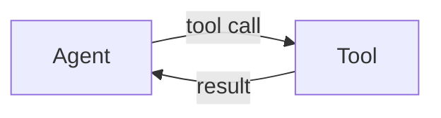

## Command-line tools

Search and language tooling beyond the coreutils, all of it on `PATH` in an
interactive shell:

- **`rg`** (ripgrep) — content search; respects `.gitignore`, so pass `-uu` to look
  inside ignored files anyway
- **`fd`** — filename and glob search (`fd -e kt`, `fd -g '**/build.gradle*'`); the
  apt package also installs it as `fdfind`
- **`fnm`** — Node versions, picked per project from `.nvmrc` / `.node-version`
- **`sdk`** (SDKMAN) — Java and Maven: `sdk current java`, `sdk use java <version>`,
  or `sdk env` to follow a project's `.sdkmanrc`
- **`uv`** — Python versions and packages (`uv venv`, `uv run`, `uv add`), plus
  `uvx` for one-off tools and `uv tool` for installed ones. It downloads its
  own interpreters, so the system `python3` (3.12) is not what a project
  ends up using

Reach for `rg` and `fd` ahead of `grep` and `find`.

`sdk` needs one caveat: it is a shell function from `sdkman-init.sh`, not a binary,
so it never reaches a non-interactive bash even though its work has — `java`,
`mvn`, `JAVA_HOME` and `node` are all already on `PATH`, exported by the shell pi
runs in. Source `~/.local/share/sdkman/bin/sdkman-init.sh` in the same command when
a `sdk` subcommand is what's wanted (`sdk use`, `sdk env`), rather than concluding
SDKMAN isn't installed.

## Terminal multiplexers

Before opening or controlling any multiplexer session, first check whether you are already inside one (`$ZELLIJ` = 0 = inside zellij, `$TMUX` set = inside tmux) and what sessions already exist (`zellij list-sessions`). If you are inside a session, work within it: never start a second multiplexer inside the one you are in, and prefer creating panes in the current session over starting a new session. Attach to an existing session rather than creating one. Never kill the existing session. For zellij command syntax, reach for the `zellij` skill.

## Diagrams

When a response or document needs a diagram, render it as a **Mermaid** code block
(```mermaid ...```) — plain ASCII/unicode art (box-drawing characters, arrows
assembled from `-->`, emoji arrows) does not survive reformatting or rendering:



Reach for a diagram when the content is **structure** — something with nodes,
branches, or actors a reader must trace:

- **Data / control flow** between components, modules, or systems → `flowchart`
- **Request lifecycles and actor interactions** over time → `sequenceDiagram`
- **Status transitions and state machines** → `stateDiagram-v2`
- **Hierarchies and taxonomies** → `flowchart TD` or `mindmap`

Prefer prose when the content is linear (one unbranched chain), already stated by
code or a table, or fewer than three nodes — a diagram there spends load without
adding structure. Label nodes with real names from the codebase, and one diagram
per concept.

Pi draws diagrams as Unicode art, so one wider than the terminal reverts to its
own source — silently, where a parse error would at least say "Mermaid diagram not
rendered". Orientation decides most of that:

- **Direction** — `TD` past three or four nodes, `LR` for short and flat shapes: a
  vertical chain spends height, while a horizontal one spends width per node
- **Cycles** — a back-edge (`C -->|retry| A`) makes `LR` loop out sideways, the
  usual reason a graph runs away in width
- **Edge labels** — the widest text in the diagram; detail reads better in node
  bodies, where `<br/>` wraps it
- **Branch labels** — `|yes|` / `|no|` can print beside the wrong column once the
  layout moves them, so `|removed → rollback|` survives better

Worth eyeballing rather than measuring — a twelve-node `LR` with long labels came
out around 290 columns, the same graph as `TD` at 90.

## Questions vs. change requests

Classify each message by intent, not grammar. A **question** wants an answer or
explanation — answer it; even when the answer implies an obvious fix, propose
the exact edit (file + snippet) and wait for a go-ahead. A **change request**
wants something changed ("fix this", "add X") — edit. A request-shaped question
is still a question, and a question-shaped request is still a request
("can you fix this?" — edit; "I wonder why this fails" — answer). When
unsure, treat the message as a question and ask.
