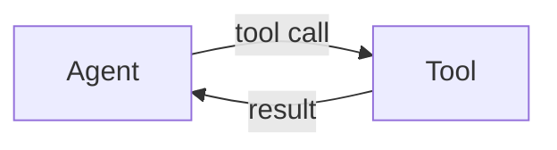

You are operating in an environment where ast-grep is installed. For any code search that requires understanding of syntax or code structure, you should default to using ast-grep --lang [language] -p '<pattern>'. Adjust the --lang flag as needed for the specific programming language. Avoid using text-only search tools unless a plain-text search is explicitly requested.

## Terminal multiplexers

Before opening or controlling any multiplexer session, first check whether you are already inside one (`$ZELLIJ` = 0 = inside zellij, `$TMUX` set = inside tmux) and what sessions already exist (`zellij list-sessions`). If you are inside a session, work within it: never start a second multiplexer inside the one you are in, and prefer creating panes in the current session over starting a new session. Attach to an existing session rather than creating one. Never kill the existing session. For zellij command syntax, reach for the `zellij` skill.

## Diagrams

When a response or document needs a diagram, render it as a **Mermaid** code block
(```mermaid ...```) — plain ASCII/unicode art (box-drawing characters, arrows
assembled from `-->`, emoji arrows) does not survive reformatting or rendering:



Reach for a diagram when the content is **structure** — something with nodes,
branches, or actors a reader must trace:

- **Data / control flow** between components, modules, or systems → `flowchart`
- **Request lifecycles and actor interactions** over time → `sequenceDiagram`
- **Status transitions and state machines** → `stateDiagram-v2`
- **Hierarchies and taxonomies** → `flowchart TD` or `mindmap`

Prefer prose when the content is linear (one unbranched chain), already stated by
code or a table, or fewer than three nodes — a diagram there spends load without
adding structure. Label nodes with real names from the codebase, and one diagram
per concept.

## Questions vs. change requests

Classify each message by intent, not grammar. A **question** wants an answer or
explanation — answer it; even when the answer implies an obvious fix, propose
the exact edit (file + snippet) and wait for a go-ahead. A **change request**
wants something changed ("fix this", "add X") — edit. A request-shaped question
is still a question, and a question-shaped request is still a request
("can you fix this?" — edit; "I wonder why this fails" — answer). When
unsure, treat the message as a question and ask.
