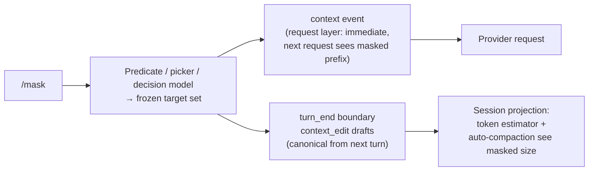

# Manual Observation Masking — Design Record

Status: designed, not yet implemented
Planned artifact: Pi extension (`extensions/mask-observations.ts` or directory form), symlinked into `~/.pi/agent/extensions/`

## Motivation

Pi's native compaction is in the LLM-Summarization camp: a structured summary
(Goal / Progress / Key Decisions / Critical Context + cumulative file lists)
replaces old turns when context crosses `contextWindow - reserveTokens`. Tool
results are truncated to 2000 chars only during *serialization for the
summarizer* — the live context keeps them verbatim until a compaction event
fires at a threshold the user doesn't control.

Research context that shaped this design:

- **The Complexity Trap** (Lindenbauer et al., arXiv 2508.21433, NeurIPS
  DL4Code 2025): simple observation masking (rolling window replacing stale
  tool outputs with placeholders) **halves cost** vs. an unmanaged agent and
  **matches or slightly beats LLM summarization** on SWE-bench Verified across
  5 model configs, generalizing to OpenHands. A hybrid saves another 7–11%.
- Their stated limitations are ours to fix: fixed windows are relevance-blind
  (can mask a still-needed read while keeping noise), findings are
  SWE-domain, triggers are heuristic.
- Adjacent work: Anthropic compaction/context editing (masking-style
  discard inside summarization), CliffCompaction (truncate/drop, never
  rephrase), AgentFold / FoldGRPO / Agent-Omit (policy decides what to fold —
  the training-heavy cousin of this design).
- Note: "observation masking" also names a different practice in agentic RL
  (excluding off-policy tool tokens from the policy-gradient loss — still the
  universal default, with newer work like ActObs/ECHO re-monetizing those
  tokens via auxiliary losses). That sense is **not** what this extension
  does; this is context management.

## Goal

A **user-triggered**, cache-aware mask of stale tool outputs from session
history, with fine-grained control over *which* outputs get masked — from
blanket age windows up to a context-aware decision model — without ever
modifying the raw session (lossless restore).

## Core decisions

### D1 — Manual trigger, not automatic

Auto-compaction fires at a threshold at an unpredictable point mid-run.
`/mask` fires when the user chooses: at a subtask boundary, when the cache is
cold anyway, or when they want headroom. Auto-compaction remains as a
backstop but fires later because the estimator sees the masked size (D3).

### D2 — The frozen set (the load-bearing rule)

At trigger time the predicate is evaluated **once** and the target set is
**frozen** (persisted via `pi.appendEntry`). The per-request `context` handler
applies membership against this fixed set.

Why: recomputing "older than N" per request would move the earliest-masked
message every request — permanently breaking the prefix cache. A frozen set
means **one deliberate cache break**, then the masked prefix is byte-stable
and the cache rebuilds normally as context grows. This also neutralizes
decision-model nondeterminism: whatever it verdicts once is locked in.

### D3 — Two-layer application



- **`context` event**: fires before each LLM call with a deep copy of
  messages; rewrite frozen tool-result content with a placeholder. Effect is
  immediate on the next request.
- **`context_edit` drafts** (`{ targetId, replacement: { content } }`) returned
  from the `turn_end` / `agent_before_settle` boundary handler: makes the
  mask *canonical* in the session projection.

Why both: Pi's auto-compaction check runs `estimateContextTokens()` over the
**canonical projection** — request-layer mutations are invisible to it.
Request-only masking wouldn't defer compaction (surprise break). Canonical
edits make the estimator see the true masked size. Raw entries stay on disk;
transcripts, exports, `/tree`, history search all still see raw history.

### D4 — Honest cache accounting

Masking old content *does* break the prefix cache at the earliest masked
message — any edit to old tokens does (compaction too). What the design buys:

- the user picks the moment (cache may be cold anyway),
- exactly **one** break, not repeated/rolling ones (D2),
- no LLM summarization call (compaction's summary request also disables
  prompt-cache writes),
- the agent's verbatim reasoning chain is preserved (Complexity Trap's core
  finding),
- partial masks break *late*: masking a few recent large outputs leaves most
  of the warm prefix intact. The approval card shows this before applying
  ("earliest masked output is turn 12/40 — ~28k tokens re-cache once").

### D5 — Selection UX: the granularity ladder

Manually picking outputs among hundreds is daunting; a blanket window is
blind. The balance: **the extension selects, the user approves.**

| Rung | Gesture | What it selects |
|---|---|---|
| 1 | `/mask 10` | blanket keepTurns window (the paper's default) |
| 2 | `/mask bash=3 read=20` | per-tool age windows |
| 3 | `/mask bash --min-chars 2000` | tool + predicates |
| 4 | `/mask` | suggested set from per-tool defaults, one approval card |
| 5 | `/mask --free 30k` | goal-directed: cheapest outputs to hit a token budget |
| 6 | `/mask pick` | cherry-pick via `ui.select` (escape hatch) |
| 7 | `/mask smart` | decision model (D7) |

Rung 4 is the default path: per-tool staleness defaults configured once
(`bash` goes stale fast; unmodified `read` stays accurate; search results are
immediately disposable), then `/mask` evaluates them and renders a single
card:

```
Suggested mask: 23 outputs, ~18.4k tokens saved
  bash ×12 (~11k) · read ×8 (~5k) · ffgrep ×3 (~2k)
Cache: breaks at turn 12, ~28k tokens re-cache once
[apply] [adjust: more/less] [cancel]
```

### D6 — Safety rails (all modes)

- Never mask the current turn's tool results (the one hard negative finding
  in the literature).
- Tool results stay paired with their calls (same rule Pi enforces for
  compaction cut points).
- `isError` results kept by default (debugging value); maskable only if
  explicitly selected.
- Placeholder = tool name + mechanical gist (bash exit code / last line,
  original size) + "re-run to restore" — the model can self-heal.
- Text-only: never silently drop image content.
- `/unmask` restores losslessly from raw entries (restoring `context_edit`s).

### D7 — Decision model (`/mask smart`)

A cheap classifier (Pi codemode `models.classify`, or a mini chat model via
`ctx.modelRegistry.complete()` as in `custom-compaction.ts`) decides
retention for the **ambiguous band only**: mid-age, mid-size, stale-unclear
reads. Clearly dead / clearly alive outputs are settled by heuristics
without a model call.

- **Joint single call** (all candidates at once, JSON verdicts +
  confidence): significance is partly a joint property — masking every read
  of a file the plan depends on is collectively catastrophic even if each
  looks individually stale. One call also amortizes context cost.
- **Confidence floor** (~0.7 probability-of-dead): uncertain → keep.
- **Error asymmetry is favorable**: over-masking costs one tool re-run
  (self-healing); under-masking compounds every subsequent request. So the
  judge may be slightly aggressive — but see D8's conservative bias.
- **Audit trail**: verdicts + confidence stored in `context_edit` details /
  custom entry, to measure re-run rate and tune before promoting the mode.
- **Benchmark honestly** (the Complexity Trap warning): LLM *summarization*
  didn't beat dumb masking on cost-benefit. Classification is far cheaper, so
  the economics differ — but heuristic card stays the default until
  tokens-saved vs. re-run rate says otherwise.

### D8 — Context-aware judging: what the decision model sees

The decision model gets the **agent's reasoning, not the observations**:

| Input section | Contents |
|---|---|
| `<task>` | compaction summary if present, else last few user messages |
| `<reasoning>` | assistant messages only — reasoning + tool calls as one-liners (per-turn capped, `serializeConversation`-style) |
| `<candidates>` | one line per output: id, tool, age, size, reference flag, head/tail snippet (~100 chars), bash exit/error line |

Excluded: **full tool outputs**. They're circular (they're the candidates),
they balloon cost back toward full-transcript levels (observations dominate
trajectories ~10:1), and the reasoning chain already contains how each output
was *used* — what the verdict actually depends on.

Mechanical pre-scan feeds the reference flag: string-match candidate outputs
(path names, identifiers, error strings, test names) against *subsequent*
assistant messages. "Referenced later" is free and syntactic; the model
handles the semantic half ("load-bearing reference" vs. "agent dismissed
it"). Verdicts run one direction: scan reasoning after each candidate's turn
→ dead / referenced / uncertain→keep.

Failure bias is conservative (referenced → kept), which is the safe
direction given D7's asymmetry.

### D9 — Standing rules (deferred, optional)

`/mask auto`: predicate applied to *new* tool results as they first enter
context — the message arrives pre-masked, prefix before it untouched, so
**zero cache cost**. Request-layer only (no `context_edit`), persisted in
`pi.getSettings()`. Open question from the discussion: whether standing
rules should also write estimator-visible edits. Default lean: request-only
(keeps projection faithful to disk history).

## Commands & config

```
/mask                 suggested-set card from per-tool defaults (rung 4)
/mask <N>             blanket keepTurns=N (rung 1)
/mask tool=N,tool=N   per-tool windows (rung 2)
/mask --min-chars N   tool + predicate filters (rung 3)
/mask --free 30k      budget-directed (rung 5)
/mask pick            interactive cherry-pick (rung 6)
/mask smart           decision model (rungs 7–8)
/unmask               clear frozen set / restore, lossless
/mask status          masked count, est. tokens, footer status line
```

```jsonc
"maskObservations": {
  "toolAges": { "bash": 3, "read": 15, "ffgrep": 5, "default": 10 },
  "minChars": 2000,
  "preserveErrors": true,
  "staleReadsOnly": true
}
```

Pair with `compaction.enabled: false` (or raised `reserveTokens` per-model
override) for full manual control, or leave auto-compaction on as a backstop
— it now fires much later since the estimator sees masked size.

## Verified Pi API surface (1.5.0)

- `pi.on("context")` — per-request message mutation (deep copy, no system
  messages); filtering/windowing is explicitly sanctioned in the docs
- `context_edit` entries + `ContextEditEntryDraft` from `turn_end` /
  `agent_before_settle` (allowed draft types: `custom`, `custom_message`,
  `context_edit`, `compaction`); projection applies latest edit per target;
  raw entries never modified
- `ctx.sessionManager.buildSessionProjection()` (read-only ctx surface);
  `ReadonlySessionManager` = getEntries/getBranch/buildSessionProjection/…
- `estimateContextTokens()` from compaction module — the estimator
  auto-compaction uses; it reads the canonical projection, hence D3
- `pi.registerCommand` + `getArgumentCompletions`; `ctx.ui.select` /
  `confirm`; `ctx.ui.setStatus` for the footer indicator
- `pi.getSettings()` for persisted config; `pi.appendEntry` for frozen-set
  state and audit trail
- `ctx.modelRegistry.complete()` / codemode `models.classify` for the
  decision model; `cacheRetention: "none"` + fresh sessionId per decision
  call (one-off requests, don't poison the cache)
- Never-mask-current-turn enforced by only offering/masking entries before
  the current turn's tool results; tool-result/call pairing preserved
  because masking replaces content of existing results in place

## Next steps

1. Scaffold `extensions/mask-observations.ts`; register in
   `package.json` `pi.extensions`; symlink; `/reload`
2. Implement rungs 1–4 + `/unmask` + `/mask status` (heuristic core,
   frozen set, two-layer application)
3. Rung 5 (`--free`), rung 6 (picker)
4. Rung 7–8 (`smart`): reference pre-scan → decision call with D8 schema →
   approval card; audit trail + re-run-rate measurement
5. Decide standing-rules scope (D9); decide auto-compaction pairing
