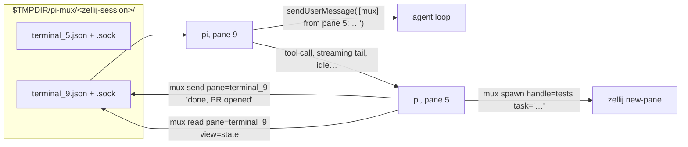

# mux — agent-to-agent messaging in zellij

**Status:** implemented (v1), pending the validation plan below
**Scope:** v1, zellij only
**Planned location:** `~/pi-packages/extensions/mux/` (`index.ts`, `tool.ts`,
`socket.ts`, `zellij.ts`), wired into `settings.json` via the `pi-packages`
package entry.

## Motivation

Multi-agent work in zellij is currently hand-assembled from the zellij skill
(raw CLI via bash) and pi-worktree (status-file polling). Observed friction:

- **Discovery ceremony** — agents run `list-sessions` → `list-panes` before
  doing anything, and re-derive pane state every turn.
- **Clunky output reading** — `dump-screen` polling loops with ANSI noise, no
  wait-for-signal primitive.
- **Polling coordination** — the coordinator babysits status files in
  `worktree_wait` rounds instead of being notified.

mux gives every pi agent inside zellij two capabilities: **addressing other
agent panes** (send messages that arrive as user messages; inspect their live
state without screen-scraping) and **spawning new agent panes** with the
environment footguns handled. There is deliberately no parent-child protocol:
any two agents are peers, so the user can open two panes by hand and prompt
them to collaborate as easily as a coordinator can spawn a fleet.
Who-reports-to-whom is a convention carried by prompts and skills, not by the
extension.

Raw multiplexer control stays in bash — agents keep direct zellij CLI access
for everything that is not an agent.

pi-worktree will eventually migrate onto this extension (see
[Migration path](#migration-path-pi-worktree)); v1 does not interoperate with
it and does not need to.

## Goals / non-goals

**Goals**

- `send`: deliver a message from one agent pane to another; it arrives as a
  user message in the recipient's conversation (turn if idle, steered mid-run if busy).
- `read`: inspect another agent pane's current activity (tool call, streaming
  text, idle state) without screen-scraping — on demand, never pushed.
- `spawn`: create a new agent pane (or tab) with correct env forwarding and
  task delivery, fire-and-forget.
- Stateless discovery — no registries, handshakes, or connection state.
- Zero declaration cost when not inside zellij.

**Non-goals (v1)**

- tmux support (v1 is zellij-only; the socket layer is multiplexer-agnostic by
  construction, only `zellij.ts` would be ported).
- Generic multiplexer tooling — raw zellij control remains bash + the zellij skill.
- Arbitrary-command panes (`mux spawn` spawns pi only).
- Git worktree creation (`spawn` takes a cwd; worktree setup stays with the
  coordinator flow, for now).
- Pushed state, reports, or crash notifications — everything is on demand.
  Coordination semantics (who reports what to whom) live in prompts/skills.
- Cross-zellij-session messaging — settled non-goal: panes in *other* zellij
  sessions are never addressable; no `session` parameter is planned.

## Architecture

Single mode — every pi instance running this extension inside zellij is a
peer. Each peer:

1. **Listens** on a unix socket at a path derived from what zellij already
   injects into every pane (`ZELLIJ_PANE_ID`, `ZELLIJ_SESSION_NAME`):

   ```
   $TMPDIR/pi-mux/<zellij-session>/<pane-id>.sock
   ```

2. **Publishes a descriptor file** next to it:

   ```
   $TMPDIR/pi-mux/<zellij-session>/<pane-id>.json   (mode 0600)
   {"socketPath": "…", "token": "…", "pid": 1234,
    "sessionName": "api-refactor", "startedAt": 1710000000000}
   ```

3. **Serves two request types** on that socket (connect–send–close, NDJSON):
   `message` (inject as user message) and `state` (live activity snapshot).

**Canonical pane naming:** socket and descriptor filenames use the bare pane
number. `$ZELLIJ_PANE_ID` is already bare (verified: `1`, not `terminal_1`);
tool `pane` arguments are normalized the same way (`terminal_17` → `17`)
before any path is built. Both sides must canonicalize or discovery misses.

Discovery is a pure function of the pane id — a sender needs no registry,
handshake, or prior relationship. `list` is computed on demand by scanning the
descriptor directory and correlating with `list-panes`.



Listener lifecycle: created on `session_start` (never from the factory — the
extension docs forbid background resources there), **and only when
`$ZELLIJ_PANE_ID` is set** — outside zellij there is no pane to address and
the tool is hidden anyway. Removed on `session_shutdown`. `/reload`
replaces the runtime: the listener comes back
at the same deterministic path with a fresh token in the descriptor. Senders
re-read the descriptor per message, so a reload is at worst a brief window of
delivery failures, not a protocol event.

### Descriptor lifecycle and pruning

Descriptors die two ways, and both are needed because each alone has a hole:
**best-effort removal at the source** and **authoritative verification at
every use**.

**Graceful removal (best effort).** On `session_shutdown` the extension closes
its listener and unlinks its own descriptor and socket file. This covers
`/exit` and pane closes that let pi shut down (SIGTERM/SIGHUP). It covers
nothing under SIGKILL, a crash, or power loss — pruning must assume it never
ran.

**Verification at use (authoritative), in two cost tiers.** The hot path
(`send`, `read`) spawns no zellij process: it re-reads the target descriptor
(already mandatory — fresh token), then `kill(pid, 0)`. The cold path (`list`)
additionally correlates every descriptor against `list-panes --json`:

| Signal | Check | Catches |
|---|---|---|
| pid alive | `kill(pid, 0)` — `ESRCH` = dead | killed/crashed pis, including ones whose pane still shows `exited` |
| pane exists | pane id present in `list-panes --json` | pid **reuse** — a fresh unrelated process answering signal 0 for the recycled number |

The signals are complementary: a reused pid false-passes signal 0 but its
pane is absent from `list-panes`; a dead pi inside a live pane is invisible to
`list-panes` alone. `list` reports a pane as a live mux agent only where both
pass; the hot path approximates that cheaply with pid alone.

**Prune rule.** Hot path: dead pid → unlink the descriptor *and* socket file,
then return the instructive error below — no delivery attempt. Cold path:
either signal failing → unlink both, omit the pane, and say it was pruned.
Unlink is same-user, idempotent, race-safe against concurrent prunes
(`ENOENT` ignored), and guarded against racing the target's `/reload`:
re-read the descriptor immediately before unlinking and abort the prune if
the on-disk `pid` no longer matches the one observed dead — a reload has
rewritten the file, and unlinking the fresh descriptor would silently drop a
live peer from the mesh until its next reload. Connect refused with a *live*
pid is never pruned: it is ambiguous (mid-`/reload`, crashed listener) and
the pane still lives.

**`send`/`read` failure taxonomy** — three instructive errors, no silent or
fallback path:

| Situation | Diagnosis | Result |
|---|---|---|
| No descriptor in the dir | pane is not a mux agent (bare pane, extension not loaded) | hard error — there is **no paste fallback** |
| Dead pid (hot) / failed signal (cold) | peer died | prune + error pointing at `mux list` |
| Connect refused, pid alive | mid-`/reload` or a crashed listener | retry-window error; if persistent, the peer is wedged — `mux read view:screen` still reaches the pane |

**Deliberately not done.** No background sweeper, no TTL or mtime staleness —
pruning rides on demand, and age is not a liveness signal (a weeks-old agent
is healthy). No `stop` special case — `mux stop` strands the target's
descriptor for at most one pruning cycle. Whole-session orphans (the zellij
session itself destroyed, so no peer of it survives to scan its directory)
are accepted garbage: `$TMPDIR` is transient, the files are ~150 bytes, and
sweeping sibling sessions would need `zellij list-sessions` correlation —
cross-session scope, rejected.

## Tool surface

A single `mux` tool with an `action` enum. One declaration, shared parameters
stated once, one guidelines block. Per-action parameters are flat optionals;
`execute()` cross-validates and returns instructive errors (`action "send"
requires "text"`) so the model self-corrects in one turn.

```typescript
Type.Object({
  action: StringEnum(["list", "send", "broadcast", "read", "spawn", "stop"]),

  // shared
  pane: Type.Optional(Type.String()), // target pane id, "17" ≡ "terminal_17"

  // send/broadcast
  text: Type.Optional(Type.String()), // message body, delivered verbatim

  // read
  view: Type.Optional(StringEnum(["state", "screen"])), // default "state"
  wait_for: Type.Optional(Type.String()),    // regex; blocks until matched (see read)
  timeout_s: Type.Optional(Type.Number()),   // default 10 for waiting reads

  // spawn
  handle: Type.Optional(Type.String()), // pane title + pi --session-id for the child
  task: Type.Optional(Type.String()),        // inline task text (written to a prompt file)
  task_file: Type.Optional(Type.String()),    // existing prompt file to pass as @file
  cwd: Type.Optional(Type.String()),          // child working directory (default: own cwd)
  model: Type.Optional(Type.String()),        // child model, "provider/modelId" (default: child's own settings)
  placement: Type.Optional(StringEnum(["right", "down", "tab"])), // default "right"
  focus: Type.Optional(Type.Boolean()),       // default false — never steal the user's focus
})
```

### Actions

| Action | Semantics |
|---|---|
| `list` | Live mux agents of the current zellij session (session names, pids), own pane marked. Bare panes are correlated against descriptors only to drive pruning — they are not mux-addressable, so they are not listed (a hidden-count note is the only trace). Computed on demand — nothing is cached; stale descriptors are verified and pruned during the scan. |
| `send` | `pane` + `text` → connect to the target's socket, deliver, disconnect. Recipient injects `[mux] from pane <id> (<sessionName>): <text>` as a user message (idle → turn, busy → `steer` — the message enters after the current assistant turn, not queued behind the whole run). No live listener → instructive delivery error — target dead (descriptor pruned), not an agent pane, or mid-`/reload`; see [Descriptor lifecycle and pruning](#descriptor-lifecycle-and-pruning). |
| `broadcast` | `text` → the same message to every live mux agent of the session: the `list` scan's agent set (verification + pruning included), the own pane excluded — self-delivery would inject into the sender's own run. Delivery is the send wire path per pane, reached fresh per target so a mid-scan reload is picked up, not failed. Per-pane outcomes; a failing pane is reported, not fatal — partial delivery is a normal result, total failure an error. |
| `read` | Inspect a pane on demand. Views below. The only blocking action (only with `wait_for`). |
| `spawn` | Create an agent pane/tab with env forwarding + task delivery (details below), register nothing, return `{paneId}`. Fire-and-forget — the new agent is an ordinary peer; whether and how it reports back is up to the prompt that tasked it. |
| `stop` | Abort the target pane (Ctrl-c if streaming) and close it. |

There is deliberately **no `wait` action and no report hook**. An agent that
wants to block can use `read` with `wait_for: "^idle$"` on `view: "state"`.
Reporting conventions ("message pane 5 when done") belong to the instructing
prompt — the coordinator and worktree skills will carry them after migration.

### The `/broadcast` slash command

The `broadcast` action has a human-invoked twin registered by the same
`registerMux` (tool.ts): `/broadcast <message>`. Same `runBroadcast` core —
the `list` scan and pruning, a fresh reach per target, per-pane outcomes —
with the flags the action never sets:

| | Invoked by | Own pane | Message |
|---|---|---|---|
| `mux broadcast` (tool action) | the agent, steered by its prompt | excluded — self-delivery would inject into the sender's own run | agent-to-agent: `[mux] from pane <id> (<session>): …` — provenance a peer needs |
| `/broadcast <message>` (slash command) | the human, typing it | included — the user wants every agent to get it, this pane's too | `human: true` on the wire request → injected verbatim: a regular user message, indistinguishable from typing, in this pane too |

Self-delivery rides the same socket path as any peer (idle → turn, busy →
steer), so the current session receives the message and starts processing
it like any user input. The fan-out report goes to the human as a UI
notification, not into the conversation. Outside zellij the command is not
registered at all (the tool hides itself there too).

### `read` views

| View | Source | Freshness | Use |
|---|---|---|---|
| `state` (default) | Socket query to the target peer's listener | Exact, mid-stream | Current tool call (name, truncated input, duration), streaming text tail, last user/assistant messages, working/idle, session file. With `wait_for`: polls the peer's live state until the pattern matches. |
| `screen` | `zellij action dump-screen` | What you see | Last resort: target stuck in a TUI dialog, target not a pi agent, terminal-level detail. `wait_for` here matches terminal output. |

`state` replies are served from events the extension already receives:
`tool_execution_start`/`end` (current tool call + duration), `message_update`
(streaming tail), `message_end` (last assistant text), `agent_start` /
`agent_settled` (working/idle).

**`wait_for` match targets:** for `state`, the pattern is matched against a
compact rendered summary line of the reply — `idle`, or
`working: bash — cargo test (41s)` — which is what makes `wait_for: "^idle$"`
meaningful; for `screen`, the terminal output.

### Declaration (hidden outside zellij)

The describe-image pattern: the tool registers active, but `prepareLoadout`
returns `hiddenDeclarations: ["mux"]` unless `$ZELLIJ` is set. Hidden
declarations also drop the tool's `promptGuidelines`, so outside zellij the
model sees nothing. Inside zellij, the guidelines say:

- Use `mux` to message and inspect other agent panes and to spawn new ones.
- Reports and coordination expectations come from the tasking prompt; deliver
  them with `mux send`.
- Keep `send` payloads brief — there is no size limit and no truncation in
  the protocol; a message is injected verbatim into the peer's context. Bulk
  data travels by file path, never inside a message.
- For raw zellij control (layouts, floating panes, arbitrary commands,
  `--block-until-*`), use bash + the zellij skill.

## Ambient context injection

At `session_start`, the `context` event injects a short block:

- **Every peer:** own pane id, zellij session name, and the note that other
  agent panes are addressable via `mux send` / `mux read` / `mux list`.
- **Spawned agents additionally** (detected via `PI_MUX_PARENT_*` env):
  creator identity — parent pane id, zellij session, cwd — plus the practical
  channel: "you were spawned by the agent in pane N (zellij session S); you
  are peers — reach them with `mux send pane=N`, inspect them with `mux read`.
  Whether and when to report back is set by your task, not by the extension."
  This stays *informational*: the injection identifies the creator and how to
  address them, but reporting expectations come from the task prompt, never
  from the protocol.

## Message delivery

- **Wire format** (one NDJSON line per request, connection closed after the
  reply):

```jsonc
// sender → recipient (agent-to-agent: provenance-prefixed on injection)
{"type": "message", "token": "…", "fromPane": "terminal_5",
 "fromSessionName": "coordinator", "text": "done, PR opened"}

// sender → recipient (the /broadcast command: human, injected verbatim)
{"type": "message", "token": "…", "fromPane": "terminal_5",
 "fromSessionName": "coordinator", "human": true, "text": "standup time"}

// sender → recipient (read view:state; replyTo correlates)
{"type": "state", "token": "…", "replyTo": "req-7"}

// recipient → sender
{"type": "state", "replyTo": "req-7", "state": "working",
 "currentToolCall": {"name": "bash", "input": "cargo test", "runningMs": 41000},
 "streamingTail": "…", "lastUserMessage": "…", "lastAssistantText": "…",
 "sessionFile": "…", "sessionName": "api-refactor"}
```

- **Injection:** the recipient calls `pi.sendUserMessage()`. Agent-to-agent
  messages are injected as `[mux] from pane <id> (<session>): …`;
  `human` messages (the `/broadcast` command) verbatim, indistinguishable
  from a regular user message. Idle → triggers a turn; busy → `deliverAs: "steer"` — the message
  steers the current run (enters after the current assistant turn), it does
  not queue behind the whole run. Messages integrate with the recipient's
  agent loop natively.
- **Auth:** every request carries the target's token from its descriptor.
  The honest threat model is the OS user account (descriptor and socket are
  `0600`); the token is defense-in-depth against same-user processes that
  guess the socket path without reading the descriptor.
- **Size:** no code-level limit and no truncation — messages are
  instructions, not data, and a truncated instruction silently changes
  meaning. A `send` injects verbatim into the recipient's context; keeping
  payloads brief is a tool guideline (see Declaration), and bulk data
  travels by file path.
- **Failure:** connect failure or token mismatch → the `send`/`read` tool
  result says so plainly (failure taxonomy in
  [Descriptor lifecycle and pruning](#descriptor-lifecycle-and-pruning));
  the sender decides what to do (retry after a moment, `list` to check).

## Spawn mechanics (zellij details)

- **Addressing:** raw pane ids only, `"17"` ≡ `"terminal_17"` (normalized).
  Pane *titles* appear in `list` as hints but never address anything — pi
  renames panes automatically, users rename them, and titles can collide.
  `handle` at spawn time sets the title *and* the pi `--session-id` — a
  stable session identity for later human `/resume`, never an addressing
  mechanism (transcripts are reached through the live peer's `state` reply).
- **Panes:** `zellij action new-pane --name <handle> --cwd <cwd> --no-focus
  -- <argv>`; the printed pane id is captured. `focus: true` drops
  `--no-focus`.
- **Tabs:** `zellij action new-tab --name <handle> --cwd <cwd> -- <argv>`
  prints the *tab* id; the pane id is resolved via `list-panes --json` by
  matching the non-plugin pane with that `tab_id`. Verified on zellij 0.46.
- **Headless-tab guard:** zellij destroys new tabs created in sessions with
  zero attached clients (verified). After a tab spawn, the extension confirms
  the pane exists; if it vanished, the result is an instructive error
  ("no attached client — attach once or use a pane instead").
- **Child argv:**
  `pi -a -n <handle> --session-id <handle>-<rand> [--model <model>] "@<taskfile>"`.
  `-a` avoids the interactive trust prompt blocking a headless child;
  `--model` selects the child's model in `"provider/modelId"` form — omitted,
  the child falls back to its own `defaultProvider`/`defaultModel` settings
  (fleet patterns typically pin a cheaper/delegate model here);
  `--session-id` gives the child's session a predictable identity (a human
  can `/resume` it later; transcript addressing goes through the live
  peer's `state` reply, not the id); the task is passed as an `@file` message
  so the child starts working immediately with no quoting hazards.
- **Task delivery:** inline `task` text is written to
  `$TMPDIR/pi-mux-task-<handle>.md`; `task_file` passes an existing file.
- **Env forwarding:** panes are spawned with the zellij server's environment,
  which lacks the interactive shell's vars. The extension snapshots
  `PI_CODING_AGENT_DIR`, `PATH`, and all `PI_*` at load and passes them via
  `env` in the argv, along with the creator vars:

```
PI_MUX_PARENT_PANE, PI_MUX_PARENT_ZELLIJ_SESSION,
PI_MUX_PARENT_CWD, PI_MUX_PARENT_PID
```

## Zellij behaviors relied on (verified on 0.46.0)

- `new-pane` / `new-tab` print the created pane/tab id to stdout — capture it.
- `list-panes --json` includes `tab_id` per pane and, with a client attached,
  covers multiple tabs — used for tab→pane resolution and `list`'s
  pane-absence pruning.
- New tabs in sessions with **zero attached clients are destroyed
  immediately**; panes are not affected. Hence the spawn-time guard.
- `go-to-tab` takes a position index, not a tab id.
- Panes get `ZELLIJ_PANE_ID` / `ZELLIJ_SESSION_NAME` injected — every peer
  self-identifies, and socket paths are deterministic, without any forwarding.
- Commands spawned via `new-pane`/`new-tab` run with the zellij server's
  environment, exec'd directly (no shell) — hence explicit env forwarding.

## Rejected alternatives

**Zellij as transport for `send`** (`paste` + `send-keys Enter` into the
recipient's composer). Far simpler — no listener, no token — but rejected:
paste lands in whatever widget is focused, so a message arriving while the
recipient shows a **confirm dialog can confirm it** (e.g. auto-approving a
permission-gated action); no structured state queries are possible (readback
degrades to `dump-screen`, the exact friction this project exists to kill);
and zellij actions carry no authentication. Socket delivery has none of these
problems at the cost of one small listener per peer. Settled: `send` is
socket-only — no paste fallback and no `via` parameter; a pane without a
listener is a hard, instructive error ([Descriptor lifecycle and
pruning](#descriptor-lifecycle-and-pruning) has the taxonomy).

**Parent-child push protocol** (an earlier iteration of this design):
persistent connections, automatic reports on every `agent_settled`, crash
detection by connection drop, reload farewells with grace timers, a spawn
registry rebuilt by handshakes. Superseded by the peer model: it assumed a
coordinator-owned fleet, could not express two user-opened panes
collaborating, pushed state the parent did not ask for, and carried
significant connection-lifecycle machinery. Reporting moved into prompts
(deliberate `mux send` calls), inspection became on-demand, and discovery
became stateless.

**`transcript` read view** (tail of the target's session file, rendered from
its JSONL). Cut after living briefly in v1: session files are the whole
conversation, so the view reads large rendered entries into the observing
agent's context — token-expensive by default — and it duplicates what
`state` already answers ("what happened": the reply carries the last
user/assistant messages, plus the session-file path for a human who wants
full history via `/resume`). Reading a peer's history is a human job;
agents ask the peer.

## Migration path (pi-worktree)

Not in v1. When mux is proven:

1. The worktree skill's spawn step (its hand-rolled
   `zellij action new-tab … env PI_WORKTREE_* pi …` line) becomes `mux spawn`.
2. The pi-worktree reporter's status-file writing is dropped entirely. The
   task prompt (worktree skill) instructs the agent to report back with
   `mux send` to the coordinator pane when done — reporting becomes an
   explicit act by the agent, visible in both transcripts.
3. The coordinator tools change shape: `worktree_status` → `mux list` +
   on-demand `mux read`; `worktree_wait` rounds → replaced by reports
   arriving as user messages, with `read view:state wait_for:"^idle$"` as the
   blocking primitive when truly needed; `worktree_message` (session-file
   scraping) → dropped with the `transcript` view — reading whole session
   files into the model's context is token-expensive, and the state reply
   already carries the last user/assistant messages.
4. The coordinator skill and pi-worktree extension are updated/retired in the
   same change; the AGENTS.md conventions (worktree location, base-branch
   config) move to the worktree skill, which keeps owning git concerns.

## Validation plan

1. `pi -e ~/pi-packages/extensions/mux/index.ts` in two panes of a scratch
   zellij session; verify both listeners and descriptors appear.
2. `send` both directions with agents idle and busy (verify turn vs queue);
   verify the `[mux] from …` formatting.
3. `read` both views against a working and an idle peer.
4. `spawn` end-to-end: pane created, env forwarded (child boots with models),
   creator context injected, task from `@file` starts work (once with an
   explicit `--model` override, once without), child reports
   back via `send` when the task prompt says to.
5. Tab spawn + headless guard (instructive error with no attached client).
6. `/reload` a peer → listener returns at the same path; `send` fails briefly
   then succeeds; descriptor token rotates correctly; a concurrent sender's
   prune is aborted by the pid re-read.
7. Kill -9 a peer → hot-path `send` returns a delivery error and unlinks
   descriptor + socket; close a pane without killing → `list` prunes it via
   the pane-absence signal; verify the files are gone in both cases.
8. Outside zellij → `mux` absent from the model's tool list, and `/broadcast`
   absent from the command list.
9. `broadcast` end-to-end: the tool action excludes the own pane and
   delivers `[mux]`-prefixed messages; `/reload`, then `/broadcast <text>`
   (human-typed) includes it — every recipient gets the message verbatim,
   no `[mux]` prefix, and the current session starts a turn on it; a pane
   dying mid-scan shows as NOT delivered, not fatal.
10. Then wire `-extensions/mux/index.ts` into the `pi-packages` entry in
   `settings.json` and validate with `/reload`.

## Open question

- Tab naming: zellij ≥0.46 draws its own working/needs-you/done markers from
  pi's OSC 7501 program status (pi-worktree hides its renames for that
  reason) — confirm mux needs no rename logic of its own.

The other former questions are settled in the body: no paste fallback
(Rejected alternatives), no cross-session `send` (Non-goals), no code-level
message truncation (Message delivery), and descriptor pruning specified in
[Descriptor lifecycle and pruning](#descriptor-lifecycle-and-pruning).
